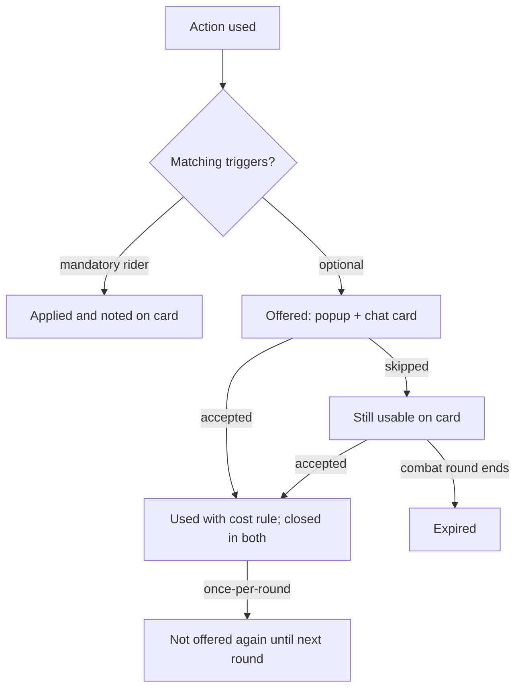
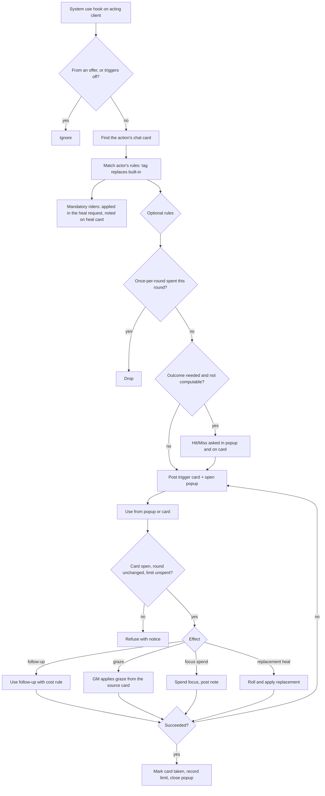

# Optional Ability Triggers - Plan

## Goal Capsule

- **Objective:** In the table-ledger Foundry module for Cosmere RPG, players and the GM no longer have to remember talents that trigger on their own actions. Foundry offers each one at the moment it applies, so free follow-up actions, waived focus and bonus healing stop being missed.
- **Means:** a data-driven trigger rule model shared by built-in rules and an item-sheet tag, detected on the system's use hook and offered through a popup plus a persistent chat card (KTD1, KTD2, KD9).
- **Product authority:** the Product Contract below. Product behavior follows the R-IDs; implementation mechanism follows the KTDs. This plan covers own-use triggers only; the other areas under How This Work Fits Together are not active scope.
- **Execution profile:** one pull request, Standard depth, units U1 to U7 in dependency order. Feature work lands on a branch from `feat/table-ledger` while PR #1 is open.
- **Stop conditions:** stop and ask if a cosmere-rpg 3.1.2 fact this plan relies on (Dependencies / Assumptions) turns out false on the local instance, or if a unit would need to change an R-ID's behavior.
- **Who finishes:** the implementer runs the Verification Contract, including the local-instance smoke, and reports the results before the PR is opened.
- **Open blockers:** none.

---

## Product Contract

Product Contract preservation: changed: R2. Its launch list is now named, and plot-die triggers are deferred (KD11), as directed by the user during planning. Also changed: R12, where accepting a graze applies the graze damage (KD12). AE8 was added to illustrate R13's sibling-card case, with no scope change. Outstanding Questions answered by research were resolved in place.

### Summary

When a character uses an action, table-ledger checks that character's talents for triggers that match. It offers the optional ones in a popup and on a chat card, applies mandatory riders automatically, and tracks once-per-round limits during combat. Trigger rules come from a built-in list for the party's talents and from a tag that can be set on any item sheet.

### Problem Frame

Many Cosmere RPG talents pay off only when a specific action is used. Combat Coordination lets a character use Decisive Command for free after a Strike. Practical Demonstration grants Rousing Presence after a successful attack. Combat Training lets a missed weapon attack graze. Swift Healer adds health equal to the healer's Medicine ranks to every heal they give.

At the table, players have to remember these on their own. Around 54 talents across the player characters use "after you…" wording, so the gap is not limited to two characters.

The cosmere-rpg system can't close it. Its item event system can fire one action from another, but it always fires and never asks the player. The trigger conditions exist only as prose in each talent's description.

### Actors

- A1. Player: uses actions for their own character and decides whether to take each offered trigger.
- A2. GM: does the same for GM-controlled actors (adversaries, NPCs) and sees the chat cards for every actor.

### Key Decisions

- KD1. **Own-use triggers first; reactions to other characters are a separate, later plan.** Reactions such as Reactive Strike need movement tracking and prompt someone who isn't acting. (session-settled: user-directed — chosen over one plan covering everything and over reactions first: own-use triggers share one trigger source and land sooner.)
- KD2. **Trigger rules come from a built-in list plus a sheet tag.** Governs R2, R3, R4. (session-settled: user-directed — chosen over built-in list only, sheet tag only, and parsing description text: known talents work with no setup, and the tag covers homebrew.)
- KD3. **A sheet tag replaces the built-in rules for the same item.** Without one winner, a talent with both would fire twice. Governs R3.
- KD4. **Accepting a trigger uses it with the talent's cost rule applied, not just a reminder.** Governs R10. (session-settled: user-directed — chosen over opening the follow-up's normal flow and over a reminder-only popup: leaving the focus waiver to memory reproduces the original problem.)
- KD5. **Once-per-round limits are tracked, as a trial to reassess after the next session.** Governs R13, R14. (session-settled: user-directed — chosen over leaving limits to the players, after first choosing not to track them: the table wants to see how tracking feels in play.)
- KD6. **Mandatory riders apply without a prompt.** Governs R11. (session-settled: user-directed — chosen over prompting for every rider and over a chat note only: a click for a bonus the rules always give is friction, and a missed click loses the bonus.) Conflict call-out: the system's heal hooks don't say who healed, so the rider can only be applied to heals the module itself rolls. Heals applied through the system's own Apply buttons get no bonus (Scope Boundaries).
- KD7. **Triggers fire for every actor, GM-controlled ones included.** Governs R5. (session-settled: user-directed — chosen over player characters only and over a GM opt-in setting.)
- KD8. **An untargeted Strike asks whether it hit before offering hit-dependent triggers.** Governs R7. Strikes no longer require a target, so the outcome can't always be computed. (session-settled: user-directed — chosen over offering both cost versions and over skipping those triggers.)
- KD9. **Offers arrive as a popup and a persistent chat card.** Governs R6, R8, R9. This follows the module's target-rolled heal flow, where the chat card survives a dismissed popup. (session-settled: user-directed — chosen over popup only and over buttons on the roll's own card: a stray dismissal must not lose the offer.)
- KD10. **Launch coverage is the party's own-use trigger talents.** Governs R2. (session-settled: user-directed — chosen over every system talent and over only the four named talents.)
- KD11. **Plot-die triggers wait for a later plan; Shadowing ships with its condition shown for the player to judge.** Governs R2. (session-settled: user-directed — chosen over adding plot-die watching to this plan and over dropping Shadowing: plot-die rolls are a second trigger source with their own reroll mechanics.)
- KD12. **Accepting Combat Training's graze applies the graze damage to the missed target.** Governs R12. (session-settled: user-directed — chosen over guiding the player to the system's graze toggle and over removing Combat Training: the system's graze is a card toggle, not an action the module can use.)

### Requirements

**Detecting triggers**

- R1. When a character uses an action, the module finds that character's talents whose trigger matches the action used (for example a Strike, a successful attack, or a heal given to another character).
- R2. A built-in list defines trigger rules for the party's own-use trigger talents: Combat Coordination, Practical Demonstration, Combat Training, Binding Strike, Swift Healer, Swift Regeneration and Shadowing.
- R3. Any item can carry a trigger tag, set on its sheet, stating what it triggers on, any outcome condition, and what it offers or adds.
- R4. Anyone who can edit an item can set or change its trigger tag.
- R5. Triggers fire for actions used by any actor, player characters and GM-controlled actors alike.

**Offering triggers**

- R6. All optional triggers matching one use are grouped into one popup for the user who used the action and one chat card posted with that use.
- R7. A trigger that depends on the outcome (hit, miss, success) uses the outcome against the target when there was one; with no target, the popup first asks whether the action hit.
- R8. An offer stays usable from the chat card until it is used or the current combat round ends; outside combat it stays usable until used.
- R9. Using an offer from either the popup or the chat card closes it in both.

**Using triggers**

- R10. Accepting a follow-up trigger asks for a target when the follow-up needs one, then uses the follow-up with the talent's cost rule applied.
- R11. Mandatory riders, which the rules always apply, are applied without a prompt and noted on the chat card (for example "+3 health from Swift Healer").
- R12. Optional riders are offered the same way as follow-up triggers; accepting Combat Training's graze applies the graze damage to the missed target.

**Limits**

- R13. A trigger limited to once per round is not offered again to that character after it is accepted, until the next combat round starts; skipping an offer does not spend it.
- R14. Outside a combat encounter, once-per-round triggers are offered every time they match.

### Key Flows

- F1. Strike with Combat Coordination
  - **Trigger:** A player's character uses a Strike.
  - **Actors:** A1
  - **Steps:** The Strike resolves. If it had no target, the popup asks Hit or Miss. The popup and a chat card offer Decisive Command as a free follow-up. The player accepts and picks the ally. Decisive Command is used, costing no focus when the Strike didn't hit.
  - **Outcome:** The follow-up happens without the player remembering the talent, and the offer closes on the card.
  - **Covered by:** R1, R6, R7, R9, R10
- F2. Heal with Swift Healer
  - **Trigger:** A character with Swift Healer heals another character through the module's target-rolled heal.
  - **Actors:** A1
  - **Steps:** The heal is rolled and applied. Swift Healer's extra health is added with no prompt, and the card notes it.
  - **Outcome:** The bonus is never forgotten and costs no extra click.
  - **Covered by:** R1, R11

### Acceptance Examples

- AE1. **Covers R7, R10.** Given a player's Strike targeted an adversary and missed, when they accept Combat Coordination, Decisive Command is used with no focus spent.
- AE2. **Covers R7, R10.** Given a player's Strike had no target, when the popup asks and they answer Hit, Decisive Command is offered and costs its usual focus.
- AE3. **Covers R13.** Given combat is running and a player accepts Combat Training's graze after a miss, when they miss again in the same round, the graze is not offered; after the next round starts, their next miss offers it again.
- AE4. **Covers R13, R14.** Given no combat encounter is active, when a player misses twice, the graze is offered both times.
- AE5. **Covers R8, R9.** Given a player closes the popup without choosing, when they click Use on the chat card in the same round, the follow-up is used and the card shows the offer as taken; once the round ends, the card's Use button no longer works.
- AE6. **Covers R13.** Given a player skips Combat Training's graze on their first miss, when they miss again in the same round, the graze is offered again.
- AE7. **Covers R3, R5.** Given the GM has tagged a homebrew adversary talent to trigger after a Strike, when that adversary strikes, the GM gets the popup and card for it.
- AE8. **Covers R12, R13.** Given a player has two open Combat Training cards from two misses in one round, when they accept the graze on one, the other card's Use no longer works that round.

### Success Criteria

- At the next session, the party's trigger talents are offered or applied whenever they match, without anyone remembering them.
- After that session, the table decides whether once-per-round tracking (R13) stays, changes or goes.

### Scope Boundaries

- Reactions to other characters' actions or movement (Reactive Strike) are deferred to a separate plan; see How This Work Fits Together.
- Plot-die triggers (Opportunist, Sure Outcome) are deferred to a separate plan (KD11).
- Limits other than once per round (once per scene, once per day) are not tracked; those triggers are offered every time.
- Uses made by hand, outside the popup or card, do not count against once-per-round limits.
- Swift Healer's bonus is not added to heals applied through the system's own Apply buttons, because the system's heal hooks carry no healer.
- Reading trigger conditions from description text is out of scope.
- The built-in list does not cover every Cosmere RPG talent; talents outside the party's use the sheet tag.
- Considered and not built: a GM relay for offer state. The acting user authors the card and owns the talent, so no GM write is needed. A relay would be worth adding if shared-character co-owners need to take offers.

<!-- ce-section: work-relationships -->
### How This Work Fits Together

This plan covers own-use triggers: talents that fire when their owner uses an action. The breakdown below is the current understanding, not a committed roadmap.

- Reactions to other characters (e.g. Reactive Strike when an enemy leaves reach)
  - Depends on this plan for the offer popup and chat card.
  - Still to decide: how movement out of reach is detected, and who is prompted.
- Plot-die triggers (Opportunist, Sure Outcome)
  - Shares the offer popup, the chat card and the once-per-round limit with this plan.
  - Still to decide: how a plot-die roll is detected and how a reroll or flip is applied.
- Charges and consumption prompts, plus strikes skipping the target picker
  - Already shipped on `feat/table-ledger`; can proceed independently of this plan.

### Dependencies / Assumptions

- The cosmere-rpg system's use hook passes only the item and use options, not the roll outcome. The hook fires after the action's chat card exists, so hit, miss and success are read from that card's d20 roll and recorded target defences (cosmere-rpg 3.1.2, `src/system/documents/item.ts:1454-1478`, `src/system/utils/generic.ts:277-326`).
- The card does not record which defence an attack tested or whether it hit; the system compares at render time (cosmere-rpg 3.1.2, `src/system/documents/chat-message.ts:259-277`).
- Using an action with `shouldConsume: false` skips all consumption, including the focus check. Leaving it unset shows the system's consume dialog. The system never spends action economy (cosmere-rpg 3.1.2, `src/system/documents/item.ts:1295-1312`).
- Talents are not actions; a talent's effect is used through its embedded default action (cosmere-rpg 3.1.2, `src/system/documents/item.ts:459`).
- Combat round hooks fire only on the client that advances the round, while `combat.round` syncs to every client (cosmere-rpg 3.1.2, `src/system/documents/combat.ts:18-47`).
- The system's item event system fires follow-up actions automatically with no player choice, so it can't express optional triggers (cosmere-rpg 3.1.2, `src/system/hooks/item-event-system/handlers/use-item.ts:72-118`). None of the party's trigger talents, or their embedded actions, carry use-triggered event rules in the world data, so the module's offers don't double up with system events.
- Target-rolled heals already post a chat card that survives a dismissed popup; offers follow the same pattern (`modules/table-ledger/src/abilities/heal-prompt.ts`).

### Sources / Research

- World data from a local test world. The party's characters between them have Combat Coordination (`combat-coordination`), Practical Demonstration (`practical-demonstration`), Combat Training (`combat-training`), Swift Healer (`swift-healer`), Swift Regeneration (`swift-regeneration`), Binding Strike (`binding-strike`), Shadowing (`shadowing`), Opportunist and Sure Outcome.
- Follow-up system ids on those actors: `decisive-command` (talent, 1 focus), `rousing-presence` (talent), `adh` (power, 1 Investiture), `field-medicine` (talent, heal formula `@skills.med.rank`), `regenerate` (action), `strike`, `gain_advantage`, and weapon items such as `unarmed`.
- cosmere-rpg 3.1.2 source (tag `release-3.1.2` of the-metalworks/cosmere-rpg): item event types in `src/system/hooks/item-event-system/events.ts`, item sheets in `src/system/applications/item/`.

---

## Planning Contract

### Key Technical Decisions

- KTD1. **One trigger rule model, shared by built-in rules and the sheet tag.** A rule names its trigger, outcome condition, defence, effect, follow-up, cost rule, limit, optionality and a display note. Built-in rules are keyed by the talent's `system.id`, so they survive renames and copies. A tag holds the same shape in an item flag and replaces the item's built-in rules (KD3). Governs R2, R3.
- KTD2. **Detect uses on the system's use hook, on the acting client.** The handler finds the action's chat card: the newest message by this user for this item with no trigger flag yet. It then matches rules against the actor's items. A use that produced no card produces no offers. Governs R1, R5.
- KTD3. **Outcome is computed from the card, and the popup asks only when it can't be.** A targeted use hits when its d20 total meets any recorded target's defence, the same comparison the system's card shows. Weapon attacks and Strikes test Physical defence. Other actions test the defence their description names, using the audit's existing defence wording rules. If the card has no targets but the module's target picker supplied one, that actor's defence is used. Otherwise the popup asks Hit or Miss, but only when a matching rule depends on the outcome. Governs R7.
- KTD4. **Cost rules map onto the system's consumption switch.** A waived cost uses the follow-up with consumption off. A normal cost leaves consumption unset, so the system's consume dialog charges it. Action cost is not modelled, because the system never spends actions. Shadowing's 3 focus is spent by the module after it checks the actor has enough. Governs R10.
- KTD5. **Follow-ups are found by system id on the same actor.** The lookup covers talents, actions and powers. Talents are used through their embedded default action. A follow-up missing from the sheet shows the offer disabled, with a "not on this character" note. Governs R10.
- KTD6. **Offer state lives on the trigger card, and limit state on the talent.** The acting user authors the card and owns the talent, so both writes need no GM. The round limit records `{combatId, round}` on the talent when an accepted use succeeds. Use buttons re-check that record and the card's own state at click time, so sibling cards for the same talent close too (AE8). Use buttons render only for the card's author and for GMs. Governs R8, R9, R13.
- KTD7. **Graze damage goes through the GM over the module socket, and the GM computes it.** A player can't change an enemy actor, and a player can author a chat card with any rolls and targets, so the card's contents are untrusted input. A `player`-access query lets the GM check that the caller owns the attacking actor and that the card's item belongs to it. The GM then rolls that item's own graze formula itself, as `heal.roll` does for heals (`modules/table-ledger/src/abilities/heal-prompt.ts`). It applies the result to the chosen target only when that target is one of the card's recorded targets and has a token on the attacker's scene. The GM records the graze on the source card before applying, so one card is grazed at most once (KD12). Governs R12.
- KTD8. **Expiry is checked against synced combat state, not round hooks.** The card stores the combat id and round when it is posted. It is expired once that combat has ended or been deleted, or its round has changed. Cards re-render on combat updates so their buttons disable on every client. A card posted outside combat never expires. Governs R8, R14.
- KTD9. **Trigger cards copy the source card's visibility.** Whisper recipients and blind setting come from the action's own card, so a private adversary roll keeps its triggers private. Governs R6.
- KTD10. **Uses started from an offer never raise offers.** The module marks those uses and its detection skips them. This also covers the target picker's veto and re-run, so only the final use is detected. Governs R1.
- KTD11. **A world setting turns triggers on or off.** It defaults to on, like `healPrompts` and `abilityGuards`. Governs R1.
- KTD12. **Swift Healer is added inside the module's heal request.** The request formula gains the healer's Medicine ranks when the healer has `swift-healer` and the target isn't the healer. The bonus stacks with Field Medicine's own success bonus. The heal card note names it. Governs R11 (KD6).
- KTD13. **Accepting Swift Regeneration rolls and applies the replacement heal.** The module applies it to the character, who owns themselves, and the trigger card says to leave the Regenerate card's normal heal unapplied. Governs R12.
- KTD14. **The trigger tag editor is injected into item sheets.** It goes into talent, action and power sheets through the core item sheet render hook, re-applied on re-render as the existing actor-sheet counter badge does. The editor shows one field per rule-model field (choice lists, an actor-item picker for the follow-up, a text note), so nobody types raw ids or markup. It writes the flag directly on change. The tag is checked by the same pure parser the rule model uses, and an invalid tag is ignored, with a warning shown on the sheet. Governs R3, R4.
- KTD15. **A follow-up counts as succeeded when the system's use hook fires for it.** `use()` returns nothing both for a cancelled consume dialog and for a successful action with no roll, so its return value can't tell them apart (cosmere-rpg 3.1.2, `src/system/documents/item.ts:1553-1579`). The module waits for the use hook for the marked follow-up (KTD10); a use that settles without the hook is treated as cancelled, and the offer stays open. Governs R9, R13.

### High-Level Technical Design

The offer lifecycle crosses the system's use hook, the module's rule engine, two UI surfaces and the GM for graze damage.

The rule model, which both built-in rules and the sheet tag use (directional; field names are settled in U1):

| Field | Values |
|---|---|
| trigger | strike or weapon attack, melee weapon attack, any attack, named action (by system id), heal given to another character |
| outcome | any, hit, miss, success |
| effect | follow-up action, graze, focus spend, replacement heal, heal bonus |
| follow-up | system id of the item to use |
| cost | normal, waived, waived on miss |
| limit | none, once per round |
| optional | yes (offered) or no (applied) |
| note | text shown in the offer, e.g. Shadowing's "if you were in cover" |

### Risks

- A cosmere-rpg update could change the chat card's target or flag shape. The module already depends on that card for the heal flow. U4 keeps the card reading in one function, so a break shows up in one place, and the local-instance smoke catches it.
- The comparison mirrors the system's own card check, which is a plain d20 total against defence with no natural-20 rule (cosmere-rpg 3.1.2, `src/system/documents/chat-message.ts:259-277`). A later system version that adds critical hits would make the module's hit check disagree with the card; U1 keeps the comparison in one pure function so it changes in one place.
- Binding Strike's focus cost reads "0 or 2" with an icon glyph in the stored text. The implementer confirms it from the raw description HTML; until then the follow-up uses the system's consume dialog so the player sets it.

---

## Implementation Units

### U1. Trigger rule model and pure matching

- **Goal:** a system-neutral rule model with matching, outcome, cost, limit and expiry decisions as pure functions.
- **Requirements:** R1, R3, R7, R8, R10, R13, R14; KTD1, KTD3, KTD6, KTD8.
- **Dependencies:** none.
- **Files:** create `modules/table-ledger/src/abilities/triggers.ts`, `modules/table-ledger/tests/abilities/triggers.test.ts`.
- **Approach:**
  1. Define the rule shape from the HTD table, plus a normalised description of one use: kind, item system id, d20 total, recorded targets with defences, picked target, and whether it heals another character.
  2. Add a tag parser that returns a rule or a reason it is invalid.
  3. Add matching that returns optional offers and mandatory riders for one use, honouring tag replacement.
  4. Add the outcome function per KTD3, returning hit, miss or unknown.
  5. Add cost resolution (waive, normal, waive on miss) given an outcome.
  6. Add limit and expiry checks against a `{combatId, round}` record and the current combat state.
- **Patterns to follow:** `modules/table-ledger/src/abilities/targeting.ts` and `audit-rules.ts` (pure, no Foundry globals); reuse `mentionsDefence` for named defences.
- **Test scenarios:**
  - A Strike use with one target whose Physical defence is 15 and a d20 total of 15 is a hit; 14 is a miss.
  - Two targets, one hit and one missed, count as a hit.
  - A use with no targets and no picked target gives an unknown outcome; with a picked target, that target's defence decides.
  - A non-weapon attack whose description names "Spiritual defense" tests Spiritual.
  - Waive-on-miss resolves to waived on a miss and normal on a hit (Combat Coordination, AE1, AE2).
  - An item with a valid tag ignores its built-in rule; an invalid tag leaves the built-in rule in force and returns its reason.
  - A once-per-round rule spent in combat C round 3 is unavailable in C round 3, available in C round 4, and available when no combat is active (AE3, AE4).
  - A card posted in combat C round 3 is expired when C is at round 4 or no longer exists; a card posted outside combat never expires.
  - A skipped offer leaves the limit unspent (AE6).
- **Verification:** the new tests pass and the module has no Foundry globals in `triggers.ts`.

### U2. Built-in rules for the party's talents

- **Goal:** built-in trigger rules for the seven talents in R2.
- **Requirements:** R2; KD10, KD11, KD12; KTD1.
- **Dependencies:** U1.
- **Files:** create `modules/table-ledger/src/adapters/cosmere/trigger-rules.ts`, `modules/table-ledger/tests/abilities/trigger-rules.test.ts`.
- **Approach:**
  1. Combat Coordination: after a Strike or weapon attack, follow up with `decisive-command`, cost waived on miss.
  2. Practical Demonstration: after a successful attack or `gain_advantage` use, follow up with `rousing-presence`, cost waived.
  3. Combat Training: after a missed weapon attack, graze, once per round.
  4. Binding Strike: after a melee weapon hit, follow up with `adh`, normal cost (Risks).
  5. Swift Healer: heal bonus, mandatory.
  6. Swift Regeneration: after `regenerate`, replacement heal using the Progression die rule.
  7. Shadowing: after a success against Spiritual defence, focus spend of 3, with the cover condition as its note.
- **Patterns to follow:** `modules/table-ledger/src/adapters/cosmere/healing.ts` (rules keyed by system id, with the source text cited in a comment).
- **Test scenarios:**
  - A missed Strike by an actor with `combat-coordination` yields one offer for `decisive-command` with cost waived; a hit yields the same offer with normal cost.
  - A successful `gain_advantage` use yields Practical Demonstration's offer; a failed one yields none.
  - A ranged weapon hit does not yield Binding Strike; a melee hit does.
  - A heal given to another character by an actor with `swift-healer` yields a mandatory rider; a self-heal yields none.
  - A `regenerate` use yields Swift Regeneration's replacement offer.
- **Verification:** each rule's test passes and each rule cites the talent text it encodes.

### U3. Offer popup and trigger chat card

- **Goal:** the system-neutral offer surfaces: one popup and one card per use, with Hit/Miss, Use, expiry and closing in both.
- **Requirements:** R6, R7, R8, R9, R13; KD9; KTD6, KTD8, KTD9.
- **Dependencies:** U1.
- **Files:** create `modules/table-ledger/src/abilities/trigger-offer.ts`, `modules/table-ledger/templates/abilities/trigger-card.hbs`; modify `modules/table-ledger/lang/parts/abilities.json`, `modules/table-ledger/styles/abilities.css`.
- **Approach:**
  1. Post the card with the offers, the source card's visibility, and the combat id and round in a module flag.
  2. Open the popup for the acting user, listing each offer with Use and Skip, plus Hit and Miss when the outcome is unknown.
  3. Route both surfaces' buttons through one handler that re-reads the card flag and the limit record at click time, calls the adapter-supplied effect, and marks the card taken only on success.
  4. Close an open popup when its card is marked taken, and re-render cards on combat updates so expired buttons disable.
  5. Show Use buttons only to the card's author and GMs, and the Hit/Miss choice on the card too, so a dismissed popup loses nothing.
- **Patterns to follow:** `modules/table-ledger/src/abilities/heal-prompt.ts` (card flag as state, render hook wiring buttons) and `target-picker.ts` (DialogV2).
- **Test scenarios:**
  - Run in the local-instance smoke, because a vitest double of DialogV2 and chat messages would only echo mocks. The click-time decisions themselves are U1's pure tests.
  - A use with two matching optional rules posts one card and one popup listing both.
  - Closing the popup without choosing leaves the card's Use working; using it there marks the card taken (AE5).
  - Using an offer in the popup marks the card taken on the GM's client too.
  - Accepting one of two open cards for the same once-per-round talent makes the other refuse with a notice (AE8).
  - Advancing the combat round disables an open card's buttons on the player's client.
  - An untargeted use with a hit-dependent rule shows Hit and Miss in both the popup and the card; answering on the card offers the right cost version.
  - A player who doesn't own the acting character sees the card without Use buttons.
- **Verification:** on the local instance a dismissed popup leaves a usable card, using it from the card closes the popup's offer, and a round change disables the card's buttons.

### U4. Cosmere use detection and effects

- **Goal:** connect the system's use hook to the rule engine and carry out each effect with its cost rule.
- **Requirements:** R1, R5, R7, R10, R12, R13; KD4, KD7, KD12; KTD2, KTD3, KTD4, KTD5, KTD7, KTD10, KTD11, KTD13, KTD15.
- **Dependencies:** U1, U2, U3.
- **Files:** create `modules/table-ledger/src/adapters/cosmere/triggers.ts`; modify `modules/table-ledger/src/adapters/cosmere/abilities.ts` (register the setting and hook, share the in-flight marker), `modules/table-ledger/lang/parts/abilities.json`.
- **Approach:**
  1. On use, skip marked and disabled cases (KTD10, KTD11), find the card (KTD2), and build the use description from its rolls, targets and the picker's choice.
  2. Collect the actor's rules from tags and built-in rules, and hand the offers to U3.
  3. Implement the effects:
     - Follow-up: look it up (KTD5) and use it with the resolved cost (KTD4); its success is detected per KTD15.
     - Focus spend: check and deduct focus, then post a note.
     - Graze: call the GM query (KTD7).
     - Replacement heal: roll and apply (KTD13).
  4. Record the round limit on the talent after a successful effect.
- **Patterns to follow:** `onUseItem` and `pickThenUse` in `modules/table-ledger/src/adapters/cosmere/abilities.ts`; `registerQuery` with `access: "player"` in `modules/table-ledger/src/queries.ts`.
- **Test scenarios:**
  - Covered by U1 and U2 for decisions. Integration is proven by the local-instance smoke: a Strike that misses offers Decisive Command, and accepting spends no focus (AE1). An untargeted Strike asks Hit or Miss (AE2). Graze damage reaches the missed adversary from a player client and spends the round limit (AE3); a second graze request for the same source card is refused. Cancelling the consume dialog for Decisive Command leaves the offer open and the limit unspent. A tagged adversary talent prompts the GM (AE7).
- **Verification:** each smoke scenario above behaves as described on the local instance with a GM and a player client connected.

### U5. Swift Healer bonus in heal requests

- **Goal:** the heal request adds Swift Healer's Medicine-rank bonus and names it.
- **Requirements:** R11; KD6; KTD12.
- **Dependencies:** U2.
- **Files:** modify `modules/table-ledger/src/adapters/cosmere/healing.ts`, `modules/table-ledger/src/abilities/healing.ts`, `modules/table-ledger/tests/abilities/healing.test.ts`, `modules/table-ledger/lang/parts/abilities.json`.
- **Approach:**
  1. Add a pure bonus function: Medicine ranks when the healer has the rider and the target differs from the healer, else zero.
  2. Apply it to the Field Medicine and Regrowth formulas in `healRequestFor`, and add the bonus to the request note.
- **Patterns to follow:** `fieldMedicineFormula` and `regrowthFormula` in `modules/table-ledger/src/abilities/healing.ts`.
- **Test scenarios:**
  - A successful Field Medicine by a healer with 3 Medicine ranks and Swift Healer on another character gives `1d8 + 3 + 3`.
  - A failed Field Medicine with Swift Healer gives `1d8 + 3`.
  - Field Medicine on the healer themselves adds no Swift Healer bonus.
  - Regrowth on another character adds the bonus; without the talent it does not.
- **Verification:** the healing tests pass and a heal card on the local instance shows the bonus in its note (F2).

### U6. Trigger tag editor on item sheets

- **Goal:** owners can view, set and clear an item's trigger tag on its sheet.
- **Requirements:** R3, R4; KD3; KTD14.
- **Dependencies:** U1.
- **Files:** create `modules/table-ledger/src/adapters/cosmere/trigger-sheet.ts`, `modules/table-ledger/templates/abilities/trigger-tag.hbs`; modify `modules/table-ledger/src/adapters/cosmere/abilities.ts` (register the hook), `modules/table-ledger/lang/parts/abilities.json`, `modules/table-ledger/styles/abilities.css`.
- **Approach:**
  1. Inject a collapsible "Trigger" section into talent, action and power sheets, editable only when the sheet is.
  2. Build the editor from the rule model's fields (KTD14): choice lists for trigger, outcome, effect, cost and limit, an optional toggle, the follow-up picked from the owning actor's items by name, and a free-text note. A Clear button removes the tag.
  3. Show the built-in rule as read-only text when the item has one and no tag.
  4. Save on change through the item flag and show the parser's reason when the tag is invalid.
- **Patterns to follow:** `onRenderSheet` in `modules/table-ledger/src/adapters/cosmere/abilities.ts` (render hook plus re-apply on re-render).
- **Test scenarios:**
  - Parsing is covered by U1. The local-instance smoke covers the rest: a player edits their own talent's tag, and a non-owner sees it read-only. A tagged talent's offer replaces its built-in one (KD3, AE7).
- **Verification:** on the local instance a tag saved on a talent survives a sheet re-render and a reload, and changes what the next matching use offers.

### U7. Docs and settings text

- **Goal:** the README and settings describe triggers, what they cover and the setting that turns them off.
- **Requirements:** R2, R14; KTD11.
- **Dependencies:** U4, U6.
- **Files:** modify `modules/table-ledger/README.md`, `modules/table-ledger/lang/parts/abilities.json`.
- **Approach:** add the feature row and a short section listing the built-in talents and the sheet tag, and state the Apply-button limit on Swift Healer.
- **Test scenarios:** Test expectation: none -- documentation and lang strings only.
- **Verification:** the README lists the seven built-in talents and the setting appears in Foundry's module settings.

---

## Verification Contract

| Gate | Command or check | Proves |
|---|---|---|
| Typecheck | `npm run typecheck` at the repo root | all units compile |
| Unit tests | `npm test` at the repo root | U1, U2, U5 decisions |
| Package | `npm run zip -w modules/table-ledger` | the module builds and packages |
| Local smoke | deploy the build to a local Foundry test instance, open a test world with a GM client and a player client, and run AE1 to AE8, F1 and F2 | U3, U4, U6 behavior end to end |

The smoke runs against cosmere-rpg 3.1.2 and Foundry 13.351, matching the production server. Test data changed during the smoke (HP, focus, combats, chat cards) is restored or deleted afterwards.

---

## Definition of Done

- Every R-ID is met as its Acceptance Examples describe, and each AE has been observed in the local smoke or a unit test.
- The Verification Contract gates pass, with results reported.
- U1, U2 and U5 have passing unit tests for their scenarios.
- The README and lang strings cover the feature and its setting.
- No dead-end or experimental code from abandoned approaches remains in the diff, and no debug output or smoke scaffolding is committed.
